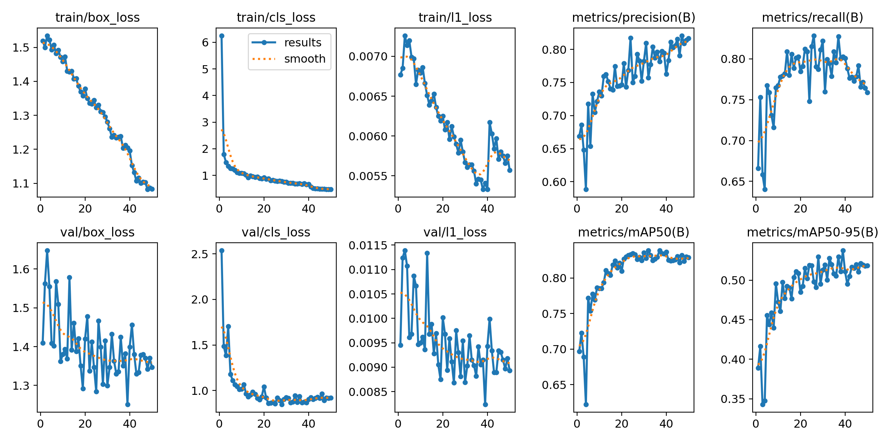
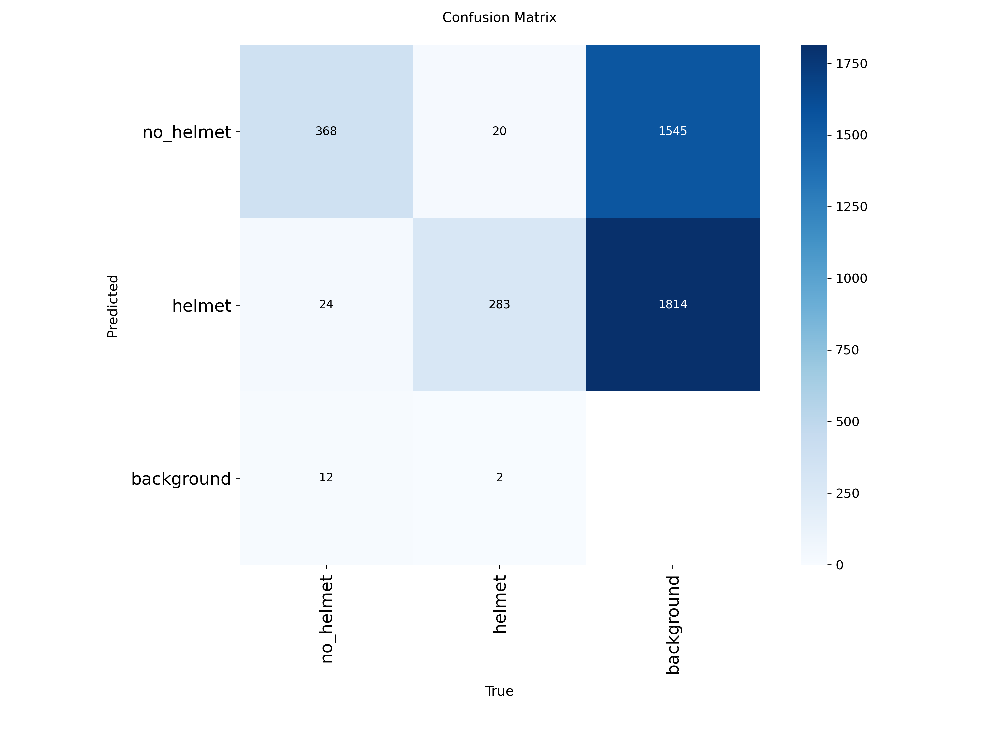
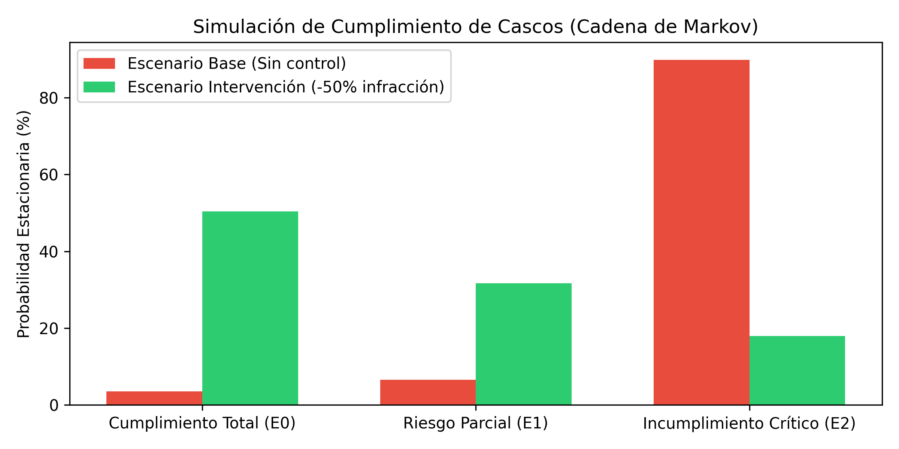

# Sistema de Detección de Cascos (EPP) y Modelado Estocástico de Riesgo Vial

Proyecto práctico de integración de Visión Artificial (**Ultralytics YOLO26**) con Modelado Matemático (**Cadenas de Markov en Tiempo Discreto**) para la evaluación de cumplimiento de seguridad vial en motociclistas.

**Autor:** Juan Toaso  

---

## 1. Descripción del Pipeline
1. **Dataset (`helmet-detection-model`):** Conjunto de datos anotado con dos clases (`0: no_helmet`, `1: helmet`) orientado al monitoreo de seguridad vial.
2. **Modelo de Visión (YOLO26n):** Entrenado durante 50 épocas (`imgsz=640`, `batch=16`, `patience=15`) sobre GPU Tesla T4.
3. **Acoplamiento Matemático (Cadenas de Markov):** Procesamiento cuadro a cuadro de video de prueba para extraer conteos dinámicos, construir la matriz de transición $P$ y simular escenarios de intervención vial.

---

## 2. Resultados del Entrenamiento (YOLO26)
El modelo alcanzó convergencia estable y capacidad de inferencia en tiempo real (**7.0 ms por imagen / ~142 FPS**):

| Clase | Imágenes Val | Instancias | Precisión (Box P) | Recall (R) | mAP@0.5 | mAP@0.5:0.95 |
| :--- | :---: | :---: | :---: | :---: | :---: | :---: |
| **Todas (`all`)** | 393 | 709 | 0.795 | 0.803 | **0.834** | 0.537 |
| **`no_helmet`** | 184 | 404 | 0.856 | 0.787 | **0.870** | 0.529 |
| **`helmet`** | 167 | 305 | 0.733 | 0.818 | **0.798** | 0.545 |

---

## 3. Modelo Matemático: Cadenas de Markov
Se modeló el estado de cumplimiento en la vía mediante un proceso estocástico $\{X_t\}_{t \ge 0}$ con espacio de estados $S = \{E_0, E_1, E_2\}$:
* **$E_0$ (Cumplimiento Total):** Todos los motociclistas detectados portan casco ($N_{\text{no\_helmet}} = 0 \land N_{\text{helmet}} > 0$).
* **$E_1$ (Riesgo Parcial):** Coexisten conductores con y sin casco ($N_{\text{no\_helmet}} > 0 \land N_{\text{helmet}} > 0$).
* **$E_2$ (Incumplimiento Crítico):** Ningún conductor porta casco ($N_{\text{no\_helmet}} > 0 \land N_{\text{helmet}} = 0$).

### Matriz de Transición Observada ($P$)
$$P = \begin{pmatrix}
0.625 & 0.125 & 0.250 \\
0.023 & 0.795 & 0.182 \\
0.013 & 0.010 & 0.977
\end{pmatrix}$$

### Simulación de Escenarios ($n = 50$ pasos)
* **Escenario Base (Sin control):** `[3.6% Cumplimiento, 6.6% Riesgo Parcial, 89.9% Incumplimiento Crítico]`
* **Escenario con Intervención (-50% transiciones críticas):** `[50.4% Cumplimiento, 31.7% Riesgo Parcial, 17.9% Incumplimiento Crítico]`

---

## 4. Estructura del Repositorio
* `Proyecto_Cascos_YOLO26.ipynb`: Notebook completo con instalación, entrenamiento, inferencia y simulación matemática.
* `weights/best.pt`: Pesos entrenados del modelo YOLO26n.
* `resultados/`: Gráficas de métricas, matriz de confusión, simulación de Markov y video procesado (`resultado_cascos.mp4`).
